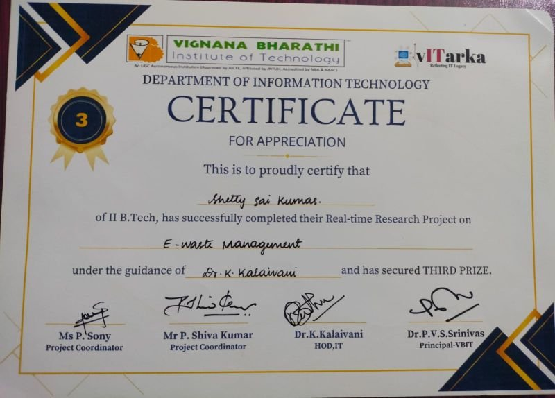

# ⚡ Sai Kumar Shetty
### **Software Engineer | Full-Stack Developer | AI & Cybersecurity Enthusiast**

  📍 <b>Hyderabad, Telangana, India</b> &nbsp;|&nbsp; 🟢 <b>Open to SDE / Full-Stack / Backend / AI & Security Opportunities</b>

---

## 👨‍💻 Executive Summary

Final-year **Information Technology** engineering student at **Vignana Bharathi Institute of Technology (VBIT)** with a multidisciplinary engineering foundation originating from an **Automobile Engineering Diploma** at Government Polytechnic College, Masab Tank. 

Hands-on track record designing and shipping production-grade full-stack applications, AI-driven autonomous systems, scalable backend APIs, and web application vulnerability assessment platforms. Focused on building practical, secure, high-performance software that solves real-world challenges.

---

## 🏆 Featured Honors & Research Awards

<table width="100%">
<tr>
<td width="55%">

### 🥉 THIRD PRIZE — Real-Time Research Project
**Project Title**: *E-Waste Management System*  
**Institution**: Vignana Bharathi Institute of Technology (VBIT)  
**Department**: Department of Information Technology (vITarka)  
**Mentors & Coordinators**: Dr. K. Kalaivani (HOD, IT), Ms P. Sony, Mr P. Shiva Kumar, Dr. P.V.S. Srinivas (Principal-VBIT)  
**Recognition**: Official *Certificate of Appreciation*  

> **Official Certificate Text**:  
> *"This is to proudly certify that Shetty sai kumar. of II B.Tech, has successfully completed their Real-time Research Project on E-waste management under the guidance of Dr. K. Kalaivani and has secured THIRD PRIZE."*

**Core System Innovations**:
- **Customer Appointment Booking**: Seamless scheduling for door-to-door electronic waste pickup.
- **Pickup Request & Live Service Tracking**: Transparent status telemetry for customers and field workers.
- **Admin Dashboard**: Centralized route planning, task assignment, and collection operations.
- **Gemini Multimodal AI Recognition**: Identifies hardware types, categorizes toxic materials, and evaluates recyclability index from uploaded photos.
- **Hyderabad E-Waste Center Matching**: Connects citizens with authorized state pollution control board (TSPCB) registered recyclers across Hyderabad.

</td>
<td width="45%" align="center">

 
<i>Official Certificate of Appreciation awarded by VBIT Dept. of Information Technology</i>

</td>
</tr>
</table>

### Additional Key Accolades
- 🥇 **1st Place Winner — Hacktoberfest 2026 Hack Day (Hyderabad)**: Ranked **1st out of 150+ software developers**; awarded Arduino UNO Q board and open-source honors.
- 🎯 **Smart India Hackathon 2026 Project Finalist**: Team Amogha (*LabelSure Legal Metrology OCR & automated compliance inspection engine*).
- ☁️ **Microsoft Certified: Azure Fundamentals (AZ-900)** (Certified July 1, 2026).
- 🛡️ **Microsoft Applied Skills: Azure Management** (Hands-on performance assessment score: **78%**).
- 🧠 **Google Cloud Gen AI Academy — APAC Cohort 3** (Specialization in Cloud Run, Agent Dev Kit, BigQuery ML, and Gemma open models).

---

## 🚀 Flagship & Featured Projects Showcase

### 1. 🛡️ AI-Powered Security Agent for Web Applications
*Autonomous Vulnerability Assessment & Policy-Enforced AI Remediation Advisor*  
**Tech Stack**: Python, FastAPI, React, Vite, SQLite, Claude AI Integration, Security Testing Plugins

- **149 Passing Backend Tests Milestone**: Verified unit & integration test coverage across scanner pipelines, parsers, and policy sandbox rules.
- **Multi-Vector Vulnerability Probes**: Heuristic detection for SQL Injection (SQLi), Reflected Cross-Site Scripting (XSS), Local File Inclusion (LFI), Server-Side Request Forgery (SSRF), and Command Injection.
- **Reconnaissance & Fingerprinting Engine**: TCP port scanning, service identification, HTTP response header fingerprinting, and dynamic directory crawling.
- **Policy-Validated AI Advisor**: Transforms raw probe anomalies into CVSS-scored remediation plans while enforcing strict deterministic safety bounds.
- **Audit-Ready Reporting**: Automated export of standardized JSON and styled HTML audit logs.

---

### 2. 📚 Need-a-Help — AI Notes Assistant
*Intelligent Document Q&A Workspace with Multi-LLM Redundancy*  
**Tech Stack**: React.js, Google Gemini API, Backboard AI, OpenRouter, Ollama (Local), Whisper, KaTeX  
🔗 **[Live Production Web App](https://need-a-help.onrender.com)** &nbsp;|&nbsp; 💻 **[GitHub Repository](https://github.com/shettysaikumar20/need-a-help)**

- Multi-format educational document upload (PDF, scans, text notes).
- Context-aware RAG question answering over study materials.
- High-availability multi-model redundancy (Gemini, OpenRouter, and local Ollama fallback).
- LaTeX mathematical formula rendering with KaTeX and syntax-highlighted code snippets.

---

### 3. ⚖️ LabelSure — Smart India Hackathon 2026
*Automated Legal Metrology Packaged Commodity Compliance Platform*  
**Team**: Team Amogha &nbsp;|&nbsp; **Tech Stack**: React, Vite, Tailwind CSS, FastAPI, Python, SQLAlchemy, PostgreSQL, PaddleOCR

- Automated parsing of MRP, net quantity, batch numbers, manufacturer details, and expiration dates from packaging photographs using PaddleOCR.
- Algorithmic compliance validation detecting missing statutory declarations and font size violations.
- Inspector dashboard with role-based access control (RBAC) and formal violation audit log generation.

---

### 4. 🎙️ FriendForge — Conversational AI Study Companion
*Voice-Enabled Interactive Learning Partner*  
**Tech Stack**: React, Backboard SDK, OpenRouter, Llama 3.1 8B, ElevenLabs Voice AI  
💻 **[GitHub Repository](https://github.com/shettysaikumar20/FriendForge)**

- End-to-end deployed audio-visual learning pipeline: User Query → Llama 3.1 8B context reasoning → ElevenLabs synthetic speech streaming → Browser audio playback.
- Interactive study dashboard breaking complex technical coursework into conversational study chapters.

---

### 5. 🌐 Sai Web Studio — Digital Agency Platform
*Client-Facing Web Development & Digital Showcase*  
**Tech Stack**: HTML5, CSS3, JavaScript, Responsive UI/UX, SEO Architecture, WhatsApp Integration

- Live interactive showcase featuring 4 distinct production template demos: EduPrime (Education), FitCore (Fitness), UrbanGlow (Lifestyle), and LaunchNest (Startups).
- Tiered transparent service packages with direct customer conversion funnels.

---

## 🛠️ Technical Skills Inventory

| Domain | Technologies & Frameworks |
|---|---|
| **Languages** | `Java` `Python` `JavaScript (ES6+)` `SQL` `C` |
| **Frontend** | `React.js` `Vite` `Tailwind CSS` `HTML5` `CSS3` `Bootstrap` |
| **Backend** | `Node.js` `Express.js` `FastAPI` `RESTful APIs` |
| **Databases** | `PostgreSQL` `MongoDB` `MySQL` `SQLite` `Firebase` |
| **AI & LLMs** | `Google Gemini API` `OpenRouter` `Backboard AI` `Ollama (Local LLMs)` `Whisper` `KaTeX` |
| **Cybersecurity** | `OWASP Top 10` `SQLi Testing` `Reflected XSS` `SSRF` `LFI` `Sandboxed Safety Policies` |
| **Cloud & DevOps** | `Microsoft Azure (AZ-900)` `AWS Basics` `Docker` `Git` `GitHub` `Postman` `Jira` |

---

## 💼 Industry Experience

### 🏎️ Technical Intern — Silver Star Mercedes-Benz (Raam Groups)
*Hyderabad, India &nbsp;|&nbsp; June 2023 – November 2023*
- Designed and maintained automated technical battery-health diagnostic reporting workflows for approximately **3,000 luxury vehicles**.
- Created Google Sheets / Apps Script data workflows for vehicle diagnostic intake and service lifecycle tracking.
- Achieved an estimated **25% improvement in diagnostic tracking reliability** and report turnaround time.

### 🛡️ Technology Intern — Supraja Technologies
*Hyderabad, India &nbsp;|&nbsp; 2024*
- Completed hands-on modules in network scanning methodologies, application security concepts, and software verification protocols.
- Submitted comprehensive technical architecture blueprints and experiment documentation.

---

## 🎓 Academic Credentials

- **B.Tech in Information Technology**  
  *Vignana Bharathi Institute of Technology (VBIT), Hyderabad* &nbsp;|&nbsp; **2023 – 2027 (Final Year)**  
  **CGPA**: `8.15 / 10`  
  *Joined through lateral entry after completing Diploma with distinction.*

- **Diploma in Automobile Engineering**  
  *Government Polytechnic College, Masab Tank, Hyderabad* &nbsp;|&nbsp; **2021 – 2024**  
  **CGPA**: `8.20 / 10`  
  *Completed with distinction; strong foundation in diagnostic engineering, mechanical systems, and applied mathematics.*

---

## 📬 Let's Connect

I am actively open to discussing software engineering internships, full-time SDE roles, full-stack development, applied AI engineering, and cybersecurity positions.

- **Email**: [shettysaikumar20@gmail.com](mailto:shettysaikumar20@gmail.com)
- **LinkedIn**: [linkedin.com/in/shetty-sai-kumar](https://www.linkedin.com/in/shetty-sai-kumar/)
- **GitHub**: [github.com/shettysaikumar20](https://github.com/shettysaikumar20)
- **Live Portfolio Website**: [shettysaikumar20.github.io/Portfolio](https://shettysaikumar20.github.io/Portfolio/)

---

  Designed & engineered by <b>Sai Kumar Shetty</b> · Powered by React 19, Vite, Tailwind CSS & GitHub Pages

